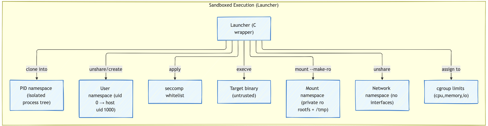
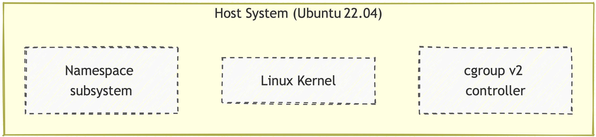

# Sandbox-by-default

Created by Kyle Parker
Nov 22, 2026

## Summary
This project is made to sandbox program when they first run, by default. Until a program is trusted, it should be sandboxed to isolate from real data. This program focuses on File-System Escape, Memory Snooping, Network Access, Privlaged Systemcalls, and Resource Exhaustion. It will enusure the program cannot access the system's file system and rather live on an isolated branch. Memory Snooping is prohibited by blocking `process_vm_writev` `process_vm_readv` and `ptrace` via compsec. Network Access is blocked by `unshare(CLONE\_NEWNET)`. Privlaged Syscalls are blocked via compsec. See (block/priv_systcall.c)[block/priv_systcall.c] for specific calls blocked. Resource Exhaustion is limited with Cgroups V2. Requires CgroupV2 compatible OS.

## Architecture Diagram



## Project Structure
**root**
- DEMO.md - Explains expected output w/ real output
- install.zsh - install required components
- main.c - Program entry
- Makefile - Make configuration
  - Uses `D_FORTIFY_SOURCE=2` to better detect flaws (buffer overflow, insecure string use) in the source code.
- README.md - Explination of project
- run.zsh - Run the program and ensure all reqs are matched. (Warning: May change settings with sudo, installs pkgs.)
- sandbox.h - Protocol Stubs

**assets - Assets to be used in MD files**
**block - contains implementations for functions which are intended to block an action (i.e., deny internet)**
- fs\_escape.c - int block_fs_escape(void) - Configures additonal fs escape methods [[FUTURE]]
- mem\_snoop.c - int block_mem_snoop(void) - Add seccomp rules
- network\_block.c - int block_net_traffic(void) - Configures additonal network escape methods [[FUTURE]]
- priv\_syscall.c - int block_priv_syscalls(void) - Add seccomp rules
- resource\_exhaust.c - int block_res_exhaust(void) - Configures additional resource exhaustion rules [[FUTURE]]

**cgroup - Cgroup V2 related config**
- cgroup.c - (many funcs) - Configures maximums for resource consumption. Please view file, comments indicate restrictions.

**malicious - "malicious" program which will simulate an attack**
- networking.c - attempt to access the outside world. Ensure nothing can get out. (Not expected to die)
- snoop\_mem.c - Attempt to snoop on system memory. (Expected to die)
- esc\_fs.c - Attempt to escape the sandboxed filesystem and read from host. (Expected to die)
- set\_uid\_root.c - Attempt to set the userid to root. (Expected to die)
- exhaust\_cpu.c - Fork bomb. (Expected to die)
- exhaust\_mem.c - Use malloc until out of memory. (Expected to die before OOM error)

**namespace - Configure namespaces**
- mount\_namespace.c - int setup_mount_namespace(void) - Places the sanbox in an isolated mount
- net\_namespace.c - int setup_net_namespace(void) - Add loopback interface if needed. [[FUTURE]]
- pid\_namespace.c - int setup_pid_namespace(void) - None, provided for symmetry. Cannot think of additional pid namespace isolation.
- user_namespace.c - int setup\_user\_namespace(void) - Unshares the current user space. 

## Prereqs
Cgroups v2 (__Default__ Ubuntu 22.04+, **Minimum** 20.04 Req)
Ensure the following apt packages are installed:
- gcc
- make
- libseccomp-dev

Install script:
```bash
sudo apt install gcc make libseccomp-dev -y
```

## Setup/Install
Simply run make as shown below. It will compile the program and run install procedures. The block below will clean the folder, make the program, then run it (with no target program).
```bash
make clean && make && ./sandbox
```
Alternative, run `./run.zsh
> [!NOTE] Upon make, a script will run requring root privlages. This will grant proper capabilites to the sandbox to ensure it can control the UUT. 

To run the program, you simply need to add a path to the untrusted exectable
```bash
./sandbox program_under_test
```

If issues occur with certian OS versions (≥ Ubuntu 20.04 && < 24.04), the following code may need to run. It will ensure Cgroup V1 is entirely disabled. Use the following script, or open /etc/default/grub (with root privlages) then find `GRUB_CMDLINE_LINUX_DEFAULT` and add `systemd.unified_cgroup_hierarchy=1 cgroup_no_v1=all` to the end of the double quotes. Then run the last two lines.
```bash
sudo sed -i '/^GRUB_CMDLINE_LINUX_DEFAULT="/ s/"$/ systemd.unified_cgroup_hierarchy=1 cgroup_no_v1=all"/' /etc/default/grub
sudo update-grub
sudo reboot
```

## Known Limitations
- Cannot detect legitmate/illegmitate network traffic
- Not all file system manipulation can be detected and blocked
- Not all programs will function in this enviroment
-  This is a lame program which focuses on specific attacks (see Arch Diagram). Advanced attacks can easily circumvent this program.

### Out of Scope
- CVE exploits
- Attacks with **existing** root access
- Physical and side-channel attacks
## Demo
[DEMO.md](/DEMO.md)

